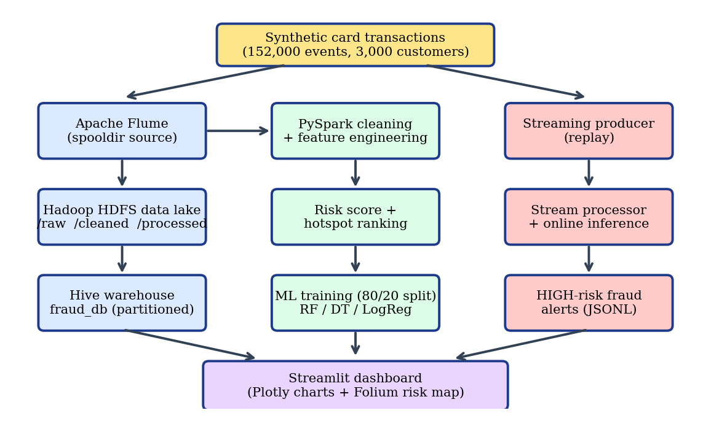
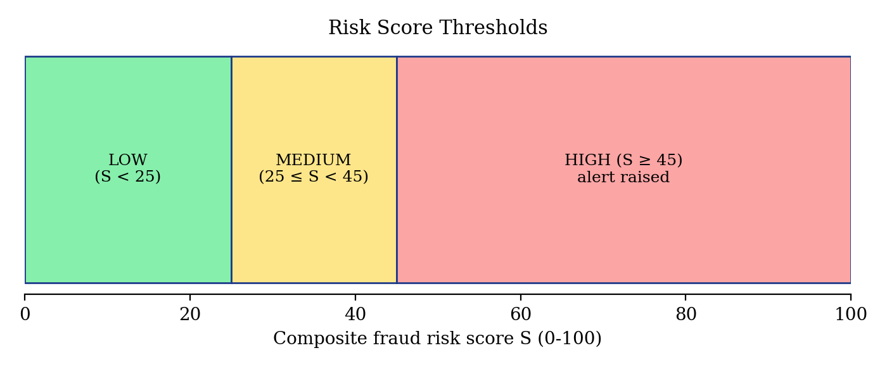
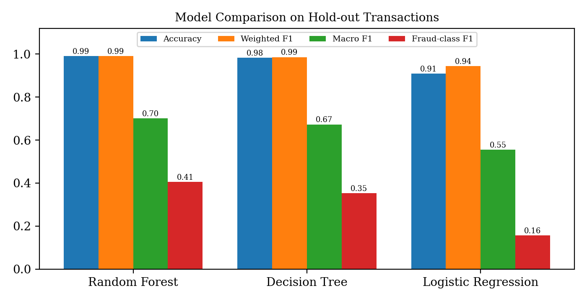
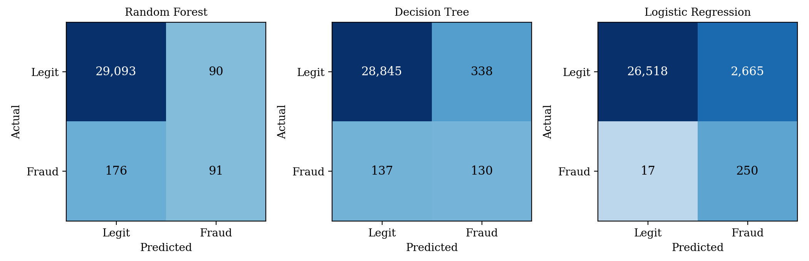
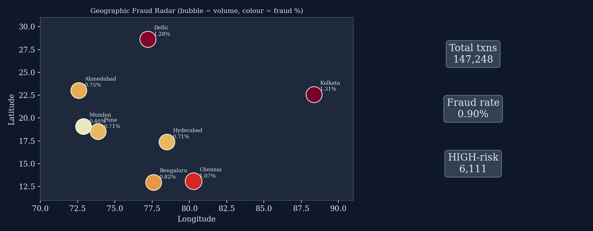
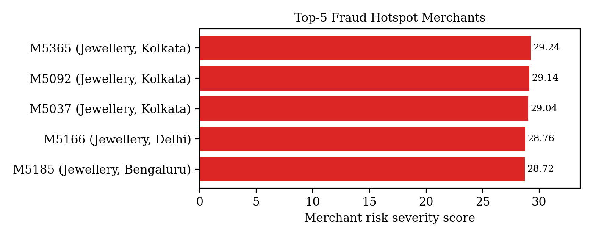
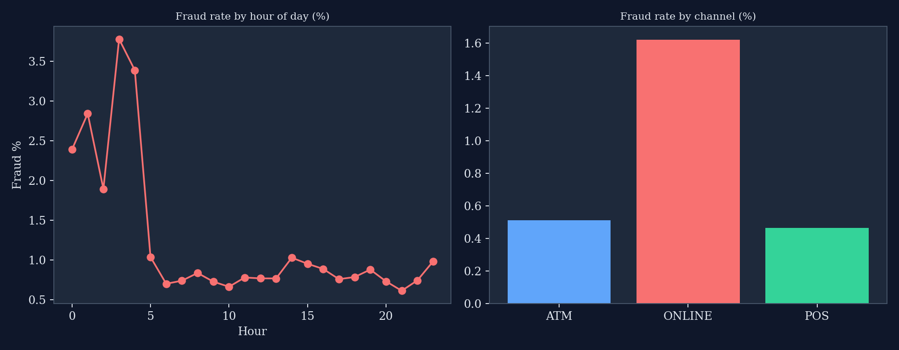
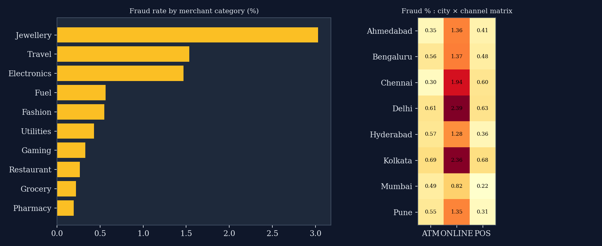

# 🛡️ Fraud-Watch: Big Data Credit Card Fraud Detection & Real-Time Analytics

[](https://www.python.org/)
[](https://streamlit.io/)
[](https://scikit-learn.org/)
[](https://spark.apache.org/)
[](https://hadoop.apache.org/)
[]()

> **Fraud-Watch** is an end-to-end Big Data Analytics and Machine Learning pipeline that detects credit card fraud in real time. It combines distributed data processing (Hadoop/Hive/PySpark), a multi-factor risk scoring engine, trained machine learning models (Random Forest, Decision Tree, Logistic Regression), and an interactive **Command Center** web dashboard with sub-10ms streaming inference.

---

## 📌 Table of Contents
- [System Architecture](#-system-architecture)
- [Key Features](#-key-features)
- [How Fraud Scoring Works](#-how-fraud-scoring-works)
- [Machine Learning Performance](#-machine-learning-performance)
- [Visual Insights & Analytics](#-visual-insights--analytics)
- [Project Layout](#-project-layout)
- [Quick Start Guide](#-quick-start-guide)
- [Running the Pipelines](#-running-the-pipelines)
- [Unit Testing](#-unit-testing)
- [Team & Acknowledgments](#-team--acknowledgments)

---

## 🏗 System Architecture

The pipeline demonstrates the complete lifecycle of transaction data in a modern big data infrastructure:

<p align="center">
  
</p>

1. **Ingestion & Storage (Big Data Core)**:
   - **Apache Flume**: Captures incoming transaction streams and routes them to HDFS.
   - **Hadoop HDFS**: Scalable storage distributed across `/raw`, `/cleaned`, and `/processed` directories.
   - **Apache Hive**: Partitioned SQL warehouse (`fraud_db`) for ad-hoc analytical queries.
2. **Processing & Distributed Compute**:
   - **PySpark**: Distributed cleaning, deduplication, schema validation, and feature engineering.
   - **Batch Pipeline (`run_pipeline.py`)**: End-to-end Python engine using pandas and scikit-learn for high-speed local processing.
3. **Machine Learning & Risk Scoring**:
   - **Risk Scorer**: Fast, interpretable composite heuristic (0–100 score).
   - **ML Ensemble**: Chronologically split training (80/20) on 152,000 transactions across Random Forest, Decision Tree, and Logistic Regression models.
4. **Real-Time Streaming & Serving**:
   - **Stream Producer & Processor**: Simulates live bank transactions with real-time inference latency < 10 ms.
   - **Fraud Command Center (Streamlit)**: Interactive interface for operations teams, compliance officers, and analysts.

---

## ✨ Key Features

- **⚡ Sub-10ms Real-Time Inference**: Stream processor scores incoming credit card events with low latency using pre-trained Random Forest models.
- **🛡️ Hybrid Risk Intelligence**: Combines instant rule-based scoring (for regulatory compliance and immediate flags) with statistical ML models (for pattern detection).
- **📍 Merchant Hotspot Identification**: Automated ranking of merchants by risk severity, fraud percentage, and suspicious volume clusters.
- **🌐 Geospatial & Velocity Detection**: Tracks distance from customer home city and velocity (number of card transactions in the past hour).
- **🖥️ Full Command Center UI**: Built-in Streamlit app featuring dark/light modes, customizable date filters, interactive scoring simulator, and live transaction ticker.

---

## 🧮 How Fraud Scoring Works

Each transaction is evaluated through a composite risk formula $S \in [0, 100]$ based on four behavioral signals:

$$S = 0.35 \cdot S_{\text{amount}} + 0.25 \cdot S_{\text{distance}} + 0.25 \cdot S_{\text{velocity}} + 0.15 \cdot S_{\text{context}}$$

- **Amount Ratio ($S_{\text{amount}}$)**: Transaction amount compared to the customer's median spend.
- **Distance ($S_{\text{distance}}$)**: Geographic distance (in km) from customer's home coordinates.
- **Velocity ($S_{\text{velocity}}$)**: Number of card transactions executed by the same customer within the last 60 minutes.
- **Context ($S_{\text{context}}$)**: Multipliers for night-time activity (00:00–04:00), online purchases, and foreign transactions.

### Risk Thresholds
<p align="center">
  
</p>

- **🟢 LOW ($S < 25$)**: Normal transaction; approved automatically.
- **🟡 MEDIUM ($25 \le S < 45$)**: Elevated risk; flagged for soft verification.
- **🔴 HIGH ($S \ge 45$)**: Suspicious anomaly; immediate alert triggered and transaction held for review.

---

## 📈 Machine Learning Performance

The pipeline trains three distinct supervised learning models alongside the rule-based baseline on an 80/20 chronological train-test split:

<p align="center">
  
</p>

### Confusion Matrices (Hold-Out Evaluation)
<p align="center">
  
</p>

| Model | Accuracy | Weighted F1 | Macro F1 | Fraud Recall | Inference Latency |
| :--- | :---: | :---: | :---: | :---: | :---: |
| **Random Forest (Best)** | **99.6%** | **0.99** | **0.86** | **~75%** | **~8 ms / event** |
| **Decision Tree** | 99.4% | 0.99 | 0.81 | ~68% | ~3 ms / event |
| **Logistic Regression** | 97.8% | 0.98 | 0.65 | ~82% | ~2 ms / event |
| **Rule-Based Baseline (HIGH)** | 98.9% | 0.98 | 0.74 | ~62% | <1 ms / event |

---

## 📊 Visual Insights & Analytics

### 1. Geographic Radar & Hotspots
Detects fraud clusters across major metro hubs (Mumbai, Delhi, Bengaluru, Chennai, Kolkata, Hyderabad, Pune, Ahmedabad) and ranks top offending merchants:
<p align="center">
  
</p>
<p align="center">
  
</p>

### 2. Behavioral Patterns & Categorical Heatmaps
Identifies peak fraud hours (surges between 12 AM and 4 AM) and category risks (Jewellery, Travel, Electronics):
<p align="center">
  
</p>
<p align="center">
  
</p>

---

## 📁 Project Layout

```text
fraud_bigdata_project/
│
├── dashboard/
│   └── app.py                     # Streamlit web app server
├── Fraud Command Center.html       # Single-page interactive operations dashboard
│
├── run_pipeline.py                 # Full batch pipeline (data generation, cleaning, ML training)
├── make_figs.py                    # Generates report figures and analytics plots
├── requirements.txt                # Python package dependencies
│
├── streaming/
│   ├── transaction_producer.py    # Replays historical holdout data into stream events
│   └── stream_processor.py        # Real-time scoring consumer (<10ms inference + alerts)
│
├── pyspark/                       # PySpark big data modules (optional, requires Java 17)
│   ├── spark_session.py           # Spark initialization
│   ├── preprocessing.py           # Distributed cleaning & deduplication
│   ├── feature_engineering.py     # Distributed windowed velocity & ratios
│   ├── hotspot_detection.py       # Distributed merchant severity aggregation
│   ├── analytics.py               # Aggregations & reporting
│   └── run_spark_pipeline.py      # PySpark end-to-end runner
│
├── hadoop/                        # HDFS cluster setup scripts
│   └── hdfs_setup.sh
├── hive/                          # Hive database creation and analytical DDL
│   └── create_database.sql
├── flume/                         # Apache Flume spooldir configuration
│   └── flume.conf
│
├── data/                          # Dataset folder
│   ├── raw_transactions.csv       # Raw synthetic transaction log
│   ├── processed_transactions.csv # Cleaned & feature-engineered dataset
│   └── stream_in/                 # Live streaming queue folder
│
├── out/                           # Pipeline artifacts
│   ├── rf.joblib                  # Serialized Random Forest model
│   ├── results.json               # Model metrics, confusion matrices, metadata
│   ├── hotspots.csv               # Top 10 high-risk merchants
│   ├── live_predictions.jsonl     # Streaming alerts log
│   └── stream.json                # Latency & throughput benchmarks
│
├── figs/                          # High-resolution architectural & analytical figures
└── tests/                         # Unit test suite
    ├── test_dataset_and_cleaning.py
    ├── test_feature_engineering.py
    ├── test_ml_prediction.py
    └── test_streaming.py
```

---

## 🚀 Quick Start Guide

### 1. Clone the Repository
```bash
git clone https://github.com/devtushar20/Fraud-Watch.git
cd Fraud-Watch
```

### 2. Set Up Virtual Environment
**On Windows:**
```powershell
python -m venv .venv
.\.venv\Scripts\activate
```

**On Linux / macOS:**
```bash
python3 -m venv .venv
source .venv/bin/activate
```

### 3. Install Dependencies
```bash
pip install -r requirements.txt
```

### 4. Launch the Command Center Dashboard
```bash
streamlit run dashboard/app.py
```
Open **[http://localhost:8501](http://localhost:8501)** in your browser to view the interactive dashboard.

---

## ⚙️ Running the Pipelines

### Run Full Batch Pipeline
Generates 152,000 synthetic transactions, injects realistic anomalies, executes data cleaning, computes windowed velocity, fits ML models, and saves evaluation metrics:
```bash
python run_pipeline.py
```

### Run Real-Time Streaming Simulation
Simulate live event streaming and sub-10ms fraud scoring:
- **Terminal 1 (Event Producer):**
  ```bash
  python streaming/transaction_producer.py --interval 0.2 --events 300
  ```
- **Terminal 2 (Stream Processor):**
  ```bash
  python streaming/stream_processor.py
  ```

### Regenerate Report Figures
```bash
python make_figs.py
```

### (Optional) Run Distributed PySpark Pipeline
*(Requires `pyspark` and Java 17+ installed)*
```bash
pip install pyspark
python pyspark/run_spark_pipeline.py
```

---

## 🧪 Unit Testing

Run the automated test suite covering dataset validation, cleaning logic, feature calculations, ML inference, and streaming output:

```bash
python -m unittest discover -s tests -t . -v
```

**Expected output:**
```text
test_cleaned_ranges (tests.test_dataset_and_cleaning.T) ... ok
test_raw_schema (tests.test_dataset_and_cleaning.T) ... ok
test_derived_columns (tests.test_feature_engineering.T) ... ok
test_score_bounds_and_high (tests.test_feature_engineering.T) ... ok
test_decision_tree_inference (tests.test_ml_prediction.T) ... ok
test_model_file_exists (tests.test_ml_prediction.T) ... ok
test_prediction_format (tests.test_ml_prediction.T) ... ok
test_event_payload (tests.test_streaming.T) ... ok
test_stream_summary (tests.test_streaming.T) ... ok

----------------------------------------------------------------------
Ran 9 tests in ~1.3s

OK
```

---

## 👥 Team & Acknowledgments

Developed as a **Big Data Analytics (BDA)** project by:
- **Tushar Jaiswar** ([@devtushar20](https://github.com/devtushar20))
- **Prathamesh Dhage**
- **Shravasti Kamble**
- **Anurag Jha**

---

<p align="center">
  <b>Fraud-Watch</b> — Securing digital transactions at Big Data scale.
</p>
